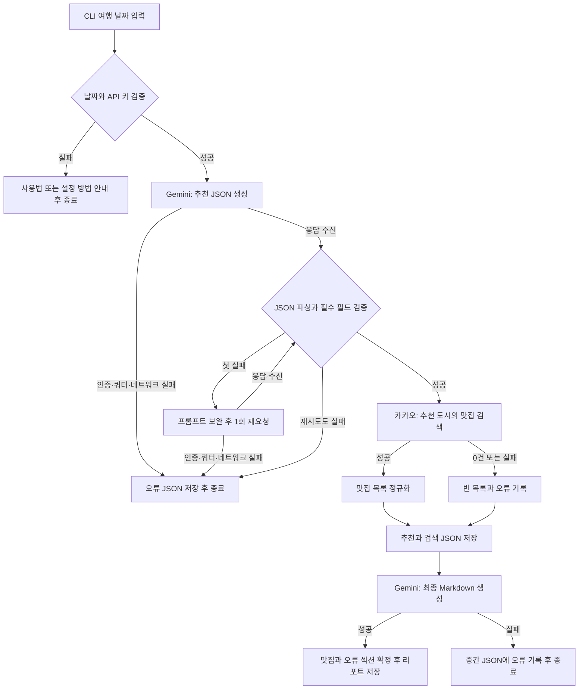

# 국내 여행 추천 CLI

**여행 날짜 하나를 입력하면 국내 여행지 추천부터 맛집 검색, 1일 일정 리포트 저장까지 진행하는 Python CLI 프로그램입니다.**

「Python 응용: API 활용 국내 여행지 추천 프로그램 개발」 과제를 바탕으로 만들었습니다. **Gemini 3.8 Flash**가 추천한 도시를 카카오 Local API의 검색 입력으로 연결하고, 두 API의 결과를 조합해 Markdown 리포트를 생성합니다. 이 프로젝트는 여러 API 사이에서 데이터를 전달하는 과정과 구조화된 AI 응답, 외부 서비스 실패 처리, API 키 관리를 다룹니다.

| 주요 설정 | 현재 구현 |
|---|---|
| 기본 LLM 모델 | Gemini 3.8 Flash (`gemini-3.8-flash`) |
| 장소 검색 | Kakao Local 키워드 검색, 음식점 최대 5곳 |
| 날짜 입력 | `--date YYYY-MM-DD` |
| 키와 모델 설정 | 프로젝트 루트의 `.env` 또는 환경변수 |
| 검증 현황 | 모의 테스트 19개 통과, 2026-10-14 실제 API 연결·리포트 저장 확인 |

최종 결과물은 다음 세 가지입니다.

- **CLI 프로그램**: 날짜 입력, 단계별 진행 로그, 결과 저장 경로 안내
- **실행 결과 파일**: 추천·맛집·오류 정보를 담은 JSON과 최종 Markdown 리포트
- **README**: 프로젝트 설명, 요구사항 구현 내용, 설치·설정·실행 방법, 검증 범위

필수 과제 범위인 **한 지역 추천**을 구현했습니다. 선택 과제인 복수 지역 추천과 캐싱은 제외했습니다. 날짜 옵션은 과제 문서에 혼용된 `-date` / `--date` 중 일반적인 긴 옵션 표기인 **`--date`로 통일**했습니다.

## 과제 요구사항과 구현 내용

아래 표는 요구사항이 코드의 어떤 동작으로 구현되어 있는지 정리한 것입니다. 구현 함수는 [travel_planner.py](./travel_planner.py)에서 확인할 수 있습니다.

| 과제 요구사항 | 구현 내용 | 관련 코드 |
|---|---|---|
| Python 3.10 이상, 터미널 실행 | Python CLI로 실행하고 진행 상황과 결과 파일 경로 출력 | `main()`, `run()` |
| argparse와 필수 날짜 옵션 | `--date YYYY-MM-DD` 필수 지정, 축약 옵션 비활성화 | `main()` |
| 잘못된 날짜 입력 처리 | 형식 검사와 실제 날짜 존재 여부 검사; 오류 시 사용법 출력 후 종료 | `parse_date()` |
| 지정된 제공자 중 LLM API 선택 | Gemini 3.8 Flash를 기본 모델로 사용하고 REST API로 추천과 리포트 생성 | `generate_text()` |
| 1차 추천을 JSON으로 생성 | JSON 응답 모드와 스키마 설정; 필수 키·타입·빈 값 검증 | `generate_text()`, `validate_recommendation()` |
| 도시·날씨·행사·추천 이유 포함 | `recommended_city`, `weather`, `events`, `reason` 생성; 행사 1~3개 검증, 추천 이유 2~4문장은 프롬프트에서 지시 | `RECOMMENDATION_SCHEMA`, `recommend()` |
| 1차 추천을 장소 검색 입력으로 연결 | 검증된 `recommended_city`로 `도시명 맛집` 검색어 구성 | `run()`, `search_restaurants()` |
| 국내 맛집 약 5곳 검색 | 카카오 키워드 검색에 음식점 필터 `FD6`와 `size=5` 전달 | `search_restaurants()` |
| 맛집 이름·주소·분류·URL·좌표 저장 | 과제의 필드로 정규화; 도로명 주소 우선 사용, 제공된 좌표는 숫자로 변환 | `search_restaurants()` |
| 검색 결과 0건일 때 계속 진행 | 빈 목록과 `EMPTY_RESULT` 오류 기록, 리포트에 `데이터 없음` 표기 | `run()`, `restaurant_section()` |
| 추천 JSON과 맛집으로 최종 Markdown 생성 | 두 데이터를 Gemini에 전달하고 제목·필수 섹션·오전/오후/저녁 표기 검증 | `generate_report()` |
| API 호출·파싱 오류를 try-except로 처리 | 인증, 쿼터, 네트워크, 시간 초과, JSON 오류를 분류해 처리 | `request_json()`, `run()` |
| 키 미설정 시 즉시 종료 | 두 필수 키 확인 후 설정 방법 안내; API 호출 전 종료 | `Settings.from_env()` |
| 장소 API 실패 시 리포트 생성 계속 | 오류 기록 후 빈 맛집 목록으로 최종 Gemini 호출 진행 | `run()` |
| LLM JSON 파싱 실패 시 재시도 최대 1회 | 파싱 또는 스키마 검증 실패 시 프롬프트를 보완해 1회 재요청 | `recommend()` |
| 내부 오류 목록 관리 | `step`, `type`, `message`를 가진 `errors` 배열 관리; JSON과 리포트에 기록 | `record_error()`, `generate_report()` |
| 환경변수 또는 .env로 키 관리 | 환경변수 우선 로딩, 키의 객체 표현 제외, 저장 텍스트의 키 값 마스킹 | `Settings`, `save_json()` |
| results/에 JSON과 Markdown 저장 | 실행 시각·여행 날짜를 포함한 이름으로 저장; JSON에 추천·맛집·오류 포함 | `run()`, `save_json()` |
| README에 사용·설정·결과·보안 안내 | 아래 설치, API 키 설정, 실행, 결과물, 보안 항목에 설명 | `README.md` |

## 프로그램 동작 흐름



1. `--date YYYY-MM-DD`를 읽고 날짜 형식과 실제 존재 여부를 검사합니다.
2. Gemini에 여행 날짜를 전달해 `recommended_city`, `weather`, `events`, `reason`을 가진 JSON을 생성합니다.
3. 추천 도시로 카카오 키워드 장소 검색을 호출합니다. 검색어는 `도시명 맛집`, 음식점 필터는 `FD6`, 요청 개수는 5곳입니다. 실제 결과는 5곳 미만일 수 있습니다.
4. 추천 JSON과 맛집 목록을 Gemini에 전달해 Markdown 리포트를 생성합니다.
5. `results/`에 JSON과 Markdown을 UTF-8로 저장하고 경로를 출력합니다.

날씨는 해당 계절의 일반적인 경향이며 실시간 예보가 아닙니다. 행사/축제는 일정 확인이 필요한 후보입니다. 별도의 날씨·행사 API를 호출하지 않습니다. 맛집은 장소 검색 결과이며 평점이나 맛의 순위를 보장하지 않습니다.

## 기술 구성과 프로젝트 구조

| 구성 | 사용 기술 | 역할 |
|---|---|---|
| 실행 환경 | Python 3.10 이상 | CLI 프로그램 실행 |
| CLI·날짜·JSON·파일 처리 | `argparse`, `datetime`, `json`, `pathlib` | 표준 라이브러리로 입력과 결과 처리 |
| HTTP 통신 | `requests` | Gemini POST 요청과 카카오 GET 요청 |
| 설정 로딩 | `python-dotenv` | `.env`에서 API 키와 모델 설정 읽기 |
| 여행 추천·리포트 | Gemini 3.8 Flash | Gemini API로 추천 JSON과 Markdown 생성 |
| 장소 검색 | Kakao Local API | 음식점 정보 검색 |
| 자동 검증 | `unittest`, `unittest.mock` | 실제 API 호출 없이 정상·실패 흐름 검증 |

```text
.
├── travel_planner.py          # CLI, API 호출, 검증, 오류 처리, 결과 저장
├── requirements.txt          # 설치할 Python 패키지
├── .env.example              # 키 값이 비어 있는 설정 예시
├── .gitignore                # 실제 키와 실행 결과 등의 Git 추적 제외
├── README.md                 # 프로젝트 소개와 사용 안내
├── results/
│   └── .gitkeep               # 결과 폴더 유지; 실행 시 JSON·Markdown 생성
└── tests/
    └── test_travel_planner.py # 19개 자동 테스트
```

## 설치

프로젝트 폴더에서 실행합니다. 아래 설정 파일 복사 명령은 `.env`가 없을 때만 복사하므로, 이미 입력한 키를 유지합니다.

macOS / Linux:

```bash
python3 -m venv .venv
source .venv/bin/activate
python -m pip install -r requirements.txt
if [ ! -f .env ]; then cp .env.example .env; fi
```

Windows PowerShell:

```powershell
py -m venv .venv
.venv\Scripts\Activate.ps1
python -m pip install -r requirements.txt
if (!(Test-Path .env)) { Copy-Item .env.example .env }
```

## API 키 설정

프로젝트 루트에서 **`.env` 파일을 열고** 두 API 키를 입력한 뒤 저장하세요. 프로그램이 실행할 때 자동으로 읽습니다.

| 파일 | 용도 | 실제 키 입력 |
|---|---|---|
| `.env` | 자신의 컴퓨터에서 사용할 설정 파일; Git 추적 제외 | 여기에 입력 |
| `.env.example` | GitHub에 공유하는 설정 양식; 키 값은 비어 있음 | 입력하지 않음 |

`.env`는 점으로 시작하는 숨김 파일입니다. macOS Finder에서는 프로젝트 폴더를 열고 **⌘ + Shift + .**을 누르면 표시됩니다. 편집기에서는 프로젝트 루트의 `.env`를 열면 됩니다.

아래는 `.env` 작성 예시입니다. 두 `YOUR_...` 자리 표시자를 본인의 키로 바꾸세요. `GEMINI_MODEL`은 그대로 두면 됩니다.

```dotenv
GEMINI_API_KEY=YOUR_GEMINI_KEY
KAKAO_REST_API_KEY=YOUR_KAKAO_REST_KEY
GEMINI_MODEL=gemini-3.8-flash
```

| 설정 이름 | 필수 여부 | 설명 |
|---|---|---|
| `GEMINI_API_KEY` | 필수 | Gemini API 키 |
| `KAKAO_REST_API_KEY` | 필수 | 카카오 REST API 키 |
| `GEMINI_MODEL` | 선택 | 미설정 시 `gemini-3.8-flash`; 다른 모델을 쓸 때 ID 지정 |

- **Gemini**: [Google AI Studio](https://aistudio.google.com/apikey)에서 API 키를 발급합니다. 구독으로 받은 크레딧을 사용한다면 해당 혜택이 적용된 결제 계정/프로젝트에 연결된 키인지 확인하세요. 프로그램은 입력된 키로 요청하며 구독 혜택을 활성화하지 않습니다.
- **카카오**: [Kakao Developers](https://developers.kakao.com/)에서 앱을 생성하고 카카오맵 API 사용 상태를 ON으로 설정한 뒤 **REST API 키**를 사용합니다. JavaScript 키나 어드민 키를 넣지 마세요. 현재 무료 쿼터는 계정에서 처음 카카오맵을 활성화한 앱에 제공되므로 기존 앱이 있다면 해당 앱의 무료 쿼터 적용 여부를 확인하세요. [사용 안내](https://developers.kakao.com/docs/ko/kakaomap/common)

`.env` 대신 환경변수를 설정해도 됩니다. **설정 우선순위는 환경변수 → `.env` → 코드 기본값**입니다. 코드 기본값은 모델에만 있으며 API 키에는 없습니다. 터미널에 예전 `GEMINI_MODEL`이 설정되어 있으면 `.env`를 바꿔도 환경변수 값으로 실행되므로 아래처럼 함께 지정하세요. 아래 키 값은 자리 표시자이며 실제 키가 아닙니다.

macOS / Linux — 현재 터미널 세션에 적용:

```bash
export GEMINI_API_KEY="YOUR_GEMINI_KEY"
export KAKAO_REST_API_KEY="YOUR_KAKAO_REST_KEY"
export GEMINI_MODEL="gemini-3.8-flash"
```

Windows PowerShell — 현재 세션에 적용:

```powershell
$env:GEMINI_API_KEY="YOUR_GEMINI_KEY"
$env:KAKAO_REST_API_KEY="YOUR_KAKAO_REST_KEY"
$env:GEMINI_MODEL="gemini-3.8-flash"
```

기본 모델은 `gemini-3.8-flash`(Gemini 3.8 Flash)입니다. 모델 제공 여부와 호출 한도는 계정에 따라 달라질 수 있습니다. [모델 목록](https://ai.google.dev/gemini-api/docs/models), [Gemini 호출 한도](https://ai.google.dev/gemini-api/docs/rate-limits)

## 실행

설치와 키 설정을 마친 뒤 가상환경이 활성화된 터미널에서 실행합니다.

```bash
python travel_planner.py --date "2026-10-14"
```

macOS / Linux에서 가상환경을 활성화하지 않았다면 프로젝트 폴더에서 다음처럼 실행할 수도 있습니다.

```bash
.venv/bin/python travel_planner.py --date "2026-10-14"
```

도움말:

```bash
python travel_planner.py --help
```

`--date`는 필수입니다. `-date`는 지원하지 않습니다. 과거 날짜는 허용하지만 `2026-2-01`, `2026-02-30` 등 잘못된 형식이나 존재하지 않는 날짜는 사용법과 오류 메시지를 출력하고 종료합니다.

2026-10-14 실제 실행에서 확인한 로그입니다. 경로의 컴퓨터별 앞부분만 `...`으로 생략했습니다. 다시 실행하면 추천 도시와 검색 결과가 달라질 수 있습니다.

```text
[1/3] 1차 추천 생성 중(Gemini)...
  - recommended_city: 경주시
[2/3] 맛집 검색 중(카카오 Local)...
  - 맛집 5곳 검색 완료
[3/3] 최종 리포트 생성 중(Gemini)...
완료! 리포트: .../results/2026-10-14_151543_742230_2026-10-14_travel_plan.md
원본 데이터: .../results/2026-10-14_151543_742230_2026-10-14_raw.json
```

정상 실행은 Gemini 2회와 카카오 1회를 호출합니다. 추천 JSON 검증 실패 시에만 Gemini를 추가로 1회 호출합니다. 같은 날짜로 재실행해도 API를 새로 호출합니다.

## 결과물 확인

결과는 실행 위치와 관계없이 `travel_planner.py` 옆의 `results/`에 저장됩니다. 파일 이름 앞부분은 **실행한 컴퓨터의 현지 실행 시각**이고, 그 뒤에 입력한 여행 날짜가 들어갑니다. 마이크로초를 포함해 같은 날짜의 반복 실행 결과도 별도 파일로 저장합니다.

실행 결과는 `.gitignore`로 제외되므로 GitHub에서 저장소를 내려받으면 결과 파일이 없습니다. API 키를 설정하고 직접 실행하면 생성됩니다. README의 실행 로그와 아래 JSON 구조 예시로 출력 형식을 확인할 수 있습니다.

- `*_raw.json`: 여행 날짜, 실행 시각, 제공자, 파싱한 추천 JSON(`recommendation`), 정규화한 맛집 목록(`restaurants`), 카카오 원본 응답(`place_search_response`), 오류 목록(`errors`), 실행 상태(`status`). 맛집의 `x`는 경도, `y`는 위도이며 숫자로 저장합니다. 제공되지 않은 좌표는 생략합니다.
- `*_travel_plan.md`: 추천 지역, 추천 이유, 날씨 요약, 행사/축제, 맛집 추천, 오전/오후/저녁 일정, 오류 요약. 맛집 섹션과 오류 요약은 코드에서 실제 검색 결과와 오류 목록으로 확정합니다.

원본 JSON의 주요 필드는 다음과 같습니다.

| 필드 | 내용 |
|---|---|
| `travel_date` | 사용자가 입력한 여행 날짜 |
| `executed_at` | 시간대 정보를 포함한 실행 시각 |
| `providers` | 사용한 API 제공자와 Gemini 모델 |
| `recommendation` | 검증을 통과한 1차 추천 JSON; 추천 실패 시 `null` |
| `restaurants` | 맛집 목록; 검색 실패 또는 0건이면 빈 배열 |
| `place_search_response` | 조회와 정규화가 성공한 카카오 원본 JSON 응답; 실패 시 `null` |
| `errors` | 발생한 오류와 재시도 과정의 오류 목록; 없으면 빈 배열 |
| `status` | `running`, `completed`, `failed` 중 실행 상태 |

아래는 **데이터 구조를 설명하기 위한 예시**입니다. 실제 API를 호출해 얻은 여행 추천 결과가 아닙니다.

`recommendation` 예시:

```json
{
  "recommended_city": "강릉",
  "weather": "가을의 일반적인 날씨 경향이며 여행 전 실제 예보 확인 필요",
  "events": ["가을 지역 문화행사 후보(개최 여부와 일정 확인 필요)"],
  "reason": "가을 바다와 산책을 즐기기 좋은 지역입니다. 해안과 도심을 함께 둘러보는 일정을 제안합니다."
}
```

맛집 한 항목은 다음 형태로 저장합니다. 아래 식당과 주소는 설명용 가상 데이터입니다.

```json
{
  "name": "예시 식당",
  "address": "강원 강릉시 예시로 1",
  "category": "음식점 > 한식",
  "url": "",
  "x": 128.9,
  "y": 37.7
}
```

리포트에는 아래 항목이 포함됩니다.

```text
# YYYY-MM-DD 국내 여행 추천 리포트
## 추천 지역
## 추천 이유
## 날씨 요약
## 행사/축제
## 맛집 추천
## 1일 일정 제안
## 오류 요약(errors)
```

검색 실패나 0건인 경우 리포트에 `데이터 없음`을 표기합니다. 오류는 아래처럼 JSON과 리포트에 함께 기록합니다.

```json
{
  "errors": [
    {"step": "place_search", "type": "AUTH_ERROR", "message": "HTTP 401. 키와 API 사용 권한을 확인하세요."}
  ]
}
```

## 오류 처리

| 상황 | 동작 |
|---|---|
| 필수 키 미설정 | API를 호출하지 않고 설정 방법 안내 후 종료 |
| 날짜 옵션 누락/날짜 오류 | argparse 사용법 출력 후 종료 |
| 추천 JSON 파싱/필수 키/타입 오류 | 수정 프롬프트로 최대 1회 재요청; 다시 실패하면 오류 JSON 저장 후 종료 |
| Gemini 인증·쿼터·네트워크 실패 | 재시도 없이 오류 JSON 저장 후 종료 |
| 카카오 인증·쿼터·네트워크·파싱 실패 | 오류 기록, 맛집 0곳으로 최종 리포트 생성 계속 |
| 카카오 검색 0건 | `EMPTY_RESULT` 기록, 맛집 '데이터 없음'으로 계속 |
| 최종 리포트 생성/형식 검증 실패 | 중간 JSON과 오류 저장 후 종료; 완성된 리포트로 저장하지 않음 |
| 파일 읽기/쓰기 실패 | 경로·권한 확인 안내 후 종료 |

HTTP 401/403은 키와 사용 권한, 429는 호출 한도와 크레딧을 확인하세요. 연결 제한은 10초, 응답 대기 제한은 60초이며 무한 재시도는 없습니다. 정상 종료 코드는 0, 설정/API/저장 실패는 1, CLI 입력 오류는 2, 사용자 중단은 130입니다. 카카오 실패 후 리포트 생성이 완료되면 종료 코드는 0이고 오류 내용은 결과물에 남습니다.

## API 키 보안

실제 키를 코드, README, `.env.example`, 로그, 결과물에 작성하거나 붙여넣지 마세요. `.env`와 실행 결과는 `.gitignore`에 등록되어 있습니다. `.env`를 별도로 첨부하거나 `git add -f`로 커밋하지 마세요. 요청 헤더와 서버 오류 본문은 출력하지 않으며, 저장할 텍스트에 설정된 키 값이 포함되면 `[REDACTED]`로 가립니다. 제출 전 결과물과 변경 파일을 확인하세요.

환경변수로 키를 분리하면 공유 시 유출을 줄이고 키 교체 시 코드를 수정할 필요가 없습니다. API 과금과 쿼터의 오용도 예방할 수 있습니다. 키를 유출했다면 제공자 콘솔에서 폐기하고 새 키를 발급하세요.

## 과제의 학습 목표와 구현 방식

REST API는 URL, HTTP 메서드, 헤더, 요청 데이터로 요청하고 상태 코드와 응답 본문을 받습니다. 이 프로그램에서 **GET**은 카카오 검색 조건을 쿼리 파라미터로 전달해 장소 데이터를 조회합니다. **POST**는 Gemini에 프롬프트와 출력 설정을 JSON 본문으로 전달해 새로운 추천/리포트를 생성하도록 요청합니다.

Gemini의 JSON 모드와 스키마를 지정하고, 반환된 텍스트를 `json.loads()`로 읽은 뒤 필수 키/타입을 검증합니다. 검증된 `recommended_city`를 카카오 검색 입력으로 연결하고, 검색 결과를 과제의 맛집 필드로 변환해 마지막 Gemini 요청에 전달합니다.

| 학습 목표 | 이 프로젝트에서 확인할 내용 |
|---|---|
| REST 요청·응답과 GET/POST 차이 이해 | GET의 검색 파라미터, POST의 JSON 본문, 인증 헤더, HTTP 상태 코드 처리 |
| LLM 출력을 다음 단계 입력으로 활용 | `recommended_city` 추출 → 장소 검색 → 추천과 맛집을 최종 리포트 입력으로 전달 |
| 대표 API 오류와 대응 원칙 이해 | 401/403 인증 오류, 429 쿼터 오류, 네트워크·시간 초과·파싱 오류를 분류하고 단계별 정책 적용 |
| API 키를 코드와 분리하는 이유 이해 | `.env`/환경변수 로딩, `.gitignore`, 키 교체 시 코드 수정 없이 설정 변경 |

공식 문서: [Gemini generateContent](https://ai.google.dev/api/generate-content), [구조화 출력](https://ai.google.dev/gemini-api/docs/structured-output), [카카오 장소 검색](https://developers.kakao.com/docs/ko/local/dev-guide)

## 테스트와 검증 범위

```bash
python -m unittest discover -s tests -v
```

**2026-10-14 기준 모의 API 테스트 19개가 통과했습니다.** 검증 환경은 Python 3.13.7이며, 소스의 Python 3.10 문법 호환성도 확인했습니다. Python 3.10 런타임에서의 실행 검증은 별도로 수행하지 않았습니다.

| 검증 항목 | 확인한 동작 |
|---|---|
| 정상 실행 | 추천 도시가 카카오 검색으로 전달되고 두 결과 파일이 저장됨 |
| 날짜 입력 | 옵션 누락, 잘못된 형식, 존재하지 않는 날짜 거절; 윤년과 과거 날짜 처리 |
| 키 설정 | 필수 키 누락 시 API 호출 전 종료; 환경변수가 `.env`보다 우선 |
| 추천 JSON | 필수 키와 타입 검증, 재시도 후 복구, 재시도 1회 한도 |
| 카카오 실패 | 검색 0건, 401/403, 429, 네트워크, JSON·좌표 오류에도 리포트 생성 계속 |
| 최종 Gemini 실패 | 중간 데이터를 보존하고 실패 상태 기록; 불완전한 리포트 저장 방지 |
| 결과 신뢰성 | 맛집 섹션에 실제 모의 검색 데이터 반영, 잘린 Gemini 응답 거절 |
| 보안·파일 처리 | 설정된 키 값이 로그·결과 파일에 노출되지 않음; 저장 경로 오류 안내 |

테스트는 [tests/test_travel_planner.py](./tests/test_travel_planner.py)에 있으며 HTTP 응답을 모의합니다. 실제 키나 네트워크 요청을 사용하지 않고 결과는 임시 폴더에 저장합니다.

**2026-10-14에 실제 Gemini·카카오 API 연결 테스트도 완료했습니다.** `--date "2026-10-14"`로 실행해 Gemini 3.8 Flash의 경주시 추천, 카카오 맛집 5곳 검색, JSON·Markdown 저장을 확인했습니다. 결과 파일의 필수 항목과 숫자 좌표, 오류 0건, 설정한 키 값의 비노출도 검사했습니다.

이 결과는 해당 계정과 실행 시점의 정상 동작을 확인한 것입니다. 구독 크레딧 차감 내역과 남은 쿼터는 별도로 확인하지 않았습니다. 실행 항목의 로그는 실제 테스트 결과이며, JSON 예시는 데이터 구조 설명용입니다. 실제 생성 파일은 테스트를 진행한 컴퓨터의 로컬 `results/`에 저장되어 있고 GitHub에는 포함되지 않습니다.
